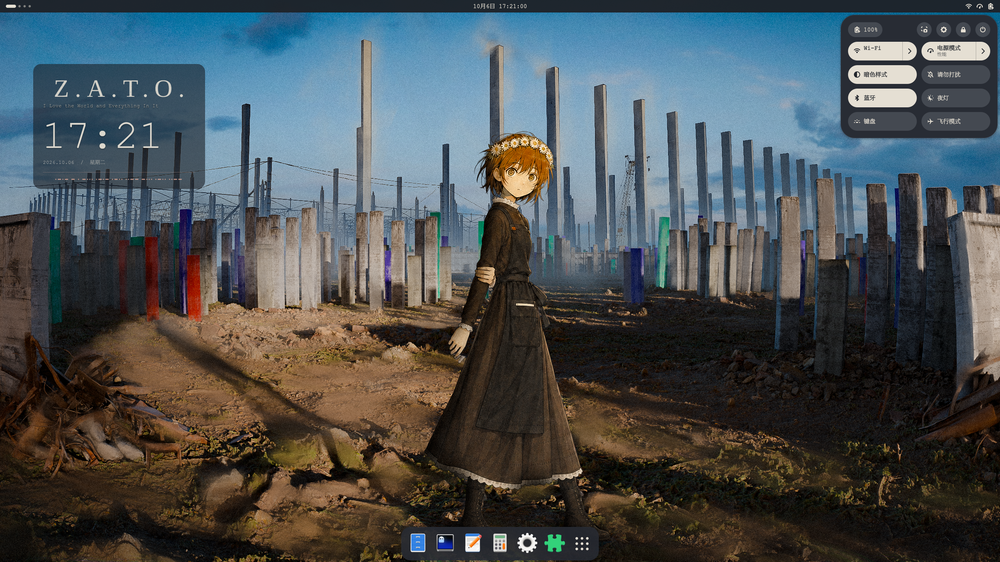
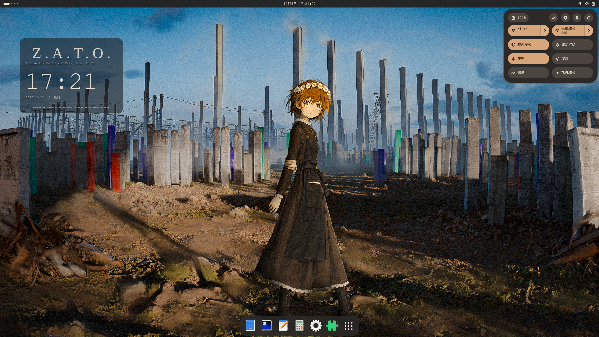
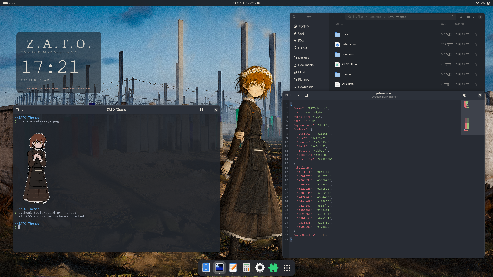
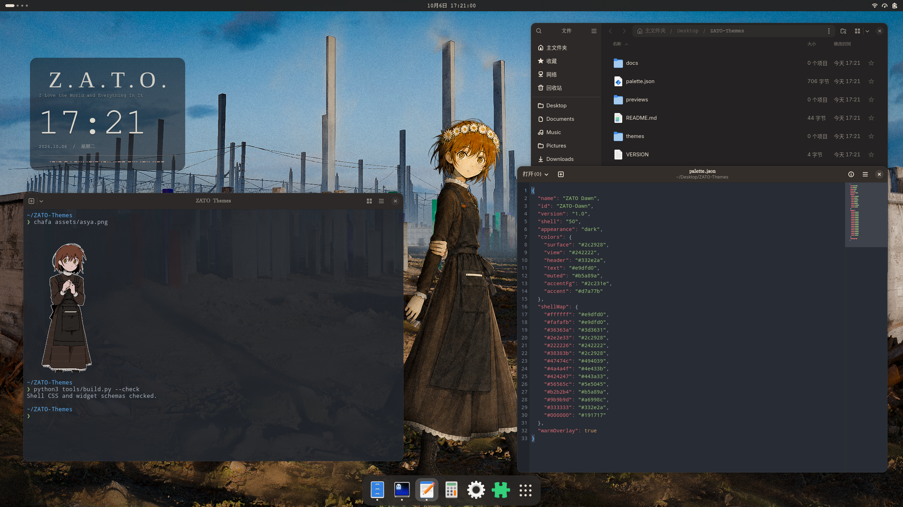

# ZATO

[English](README.md)

受 *Z.A.T.O. // I Love the World and Everything In It* 启发的两款 GNOME 暗色主题。

**Night · 极夜**采用冷蓝灰底色与纸白色强调色；**Dawn · 晨光**采用暖炭灰底色与琥珀色强调色。

| | Night · 极夜 | Dawn · 晨光 |
| --- | --- | --- |
| 桌面 |  |  |
| 应用 |  |  |

版本 **1.0** · Fedora 44 · GNOME Shell 50.5 · Wayland

## 包含内容

- GNOME Shell 主题。
- GTK 3 和 GTK 4/libadwaita 配色。
- 可选的桌面时钟，显示 ZATO 标题与摩尔斯电码。

## 安装

安装 [User Themes 扩展](https://extensions.gnome.org/extension/19/user-themes/)，然后在项目目录下执行：

```sh
mkdir -p "$HOME/.local/share/themes"
cp -R themes/ZATO-Night themes/ZATO-Dawn "$HOME/.local/share/themes/"
```

在 GNOME Tweaks → 外观 → Shell 中选择 **ZATO-Night** 或 **ZATO-Dawn**。

使用 ZIP 安装包时，将主题目录解压到 `~/.local/share/themes/`。

- [GTK 设置与还原](docs/GTK.md)
- [桌面时钟安装与设置](docs/WIDGET.md)

## 字体

可选字体：**BoYa-Courier-Mix**、**KingHwaOldSong-GB**。字体不随项目分发，未安装时使用系统字体。

## 构建

需要 Python 3 和 `glib-compile-schemas`。

```sh
python3 tools/build.py
python3 tools/build.py --check
python3 tools/build.py --release
```

安装包与校验文件生成到 `dist/`。

## 移除

将 Shell 主题切换为 **Default**，再删除 `~/.local/share/themes/` 中的主题目录。按照 [GTK 文档](docs/GTK.md) 还原应用样式；若安装了时钟扩展，一并卸载。

## 致谢与许可

- 视觉参考：*Z.A.T.O. // I Love the World and Everything In It*。
- 截图壁纸：B 站用户 **@MaidCore_Town**。
- 基础样式：[GNOME Shell](https://gitlab.gnome.org/GNOME/gnome-shell)、GTK / Adwaita。
- Dock：[Dash to Dock](https://github.com/micheleg/dash-to-dock)。

原创代码与素材采用 [GPL-2.0-or-later](LICENSE)。第三方素材署名与许可见 [THIRD_PARTY.md](THIRD_PARTY.md)。
